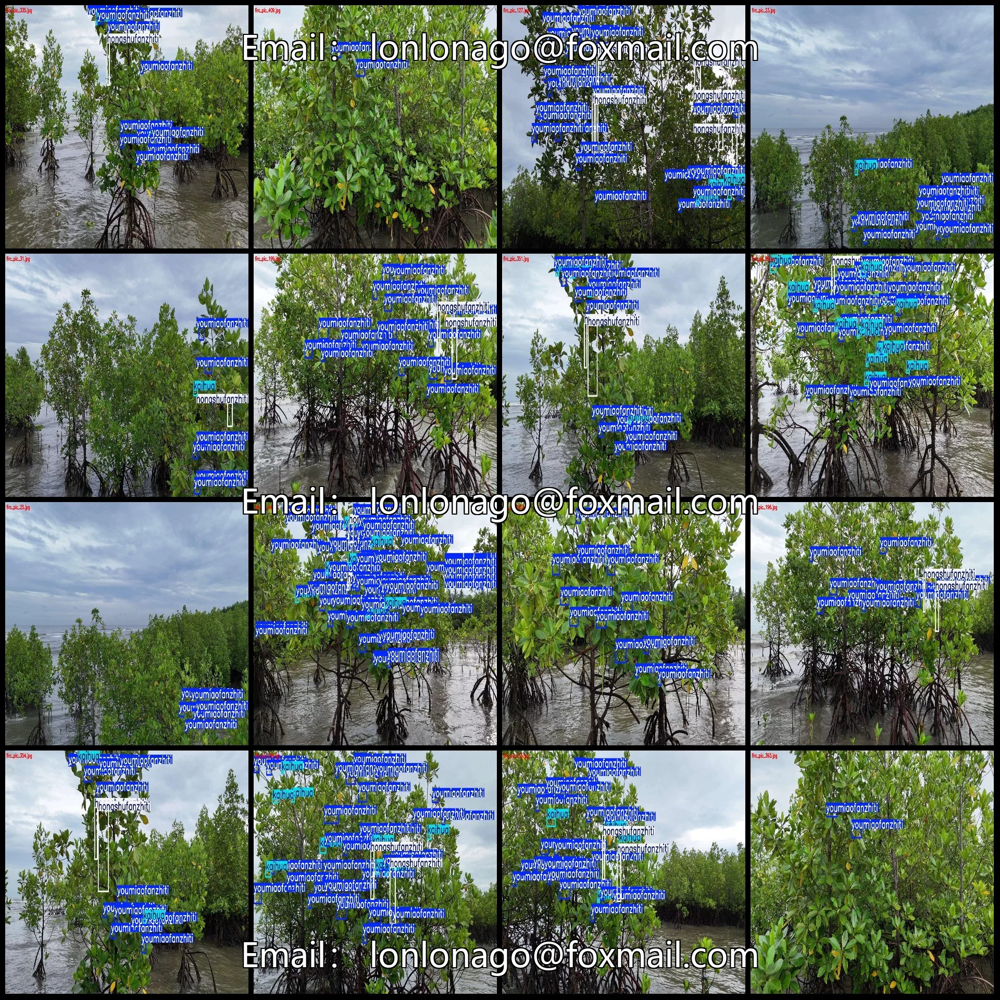
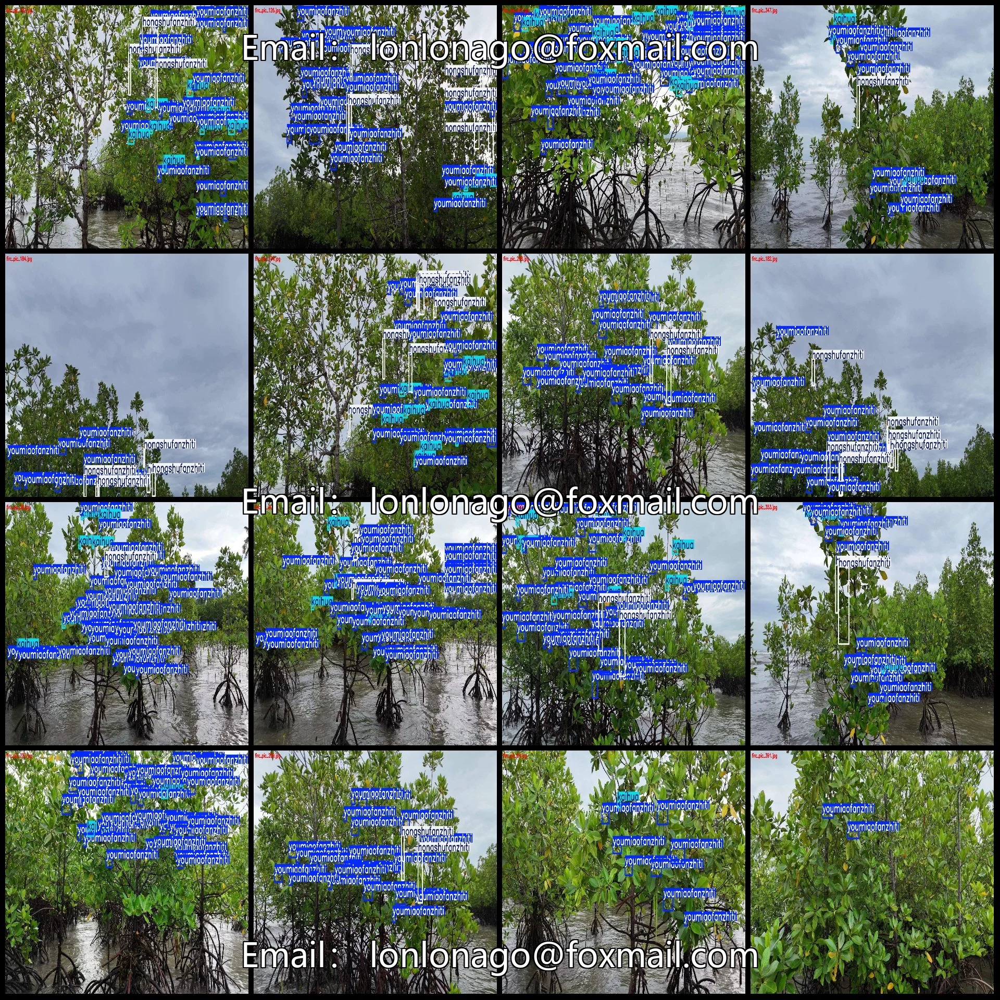
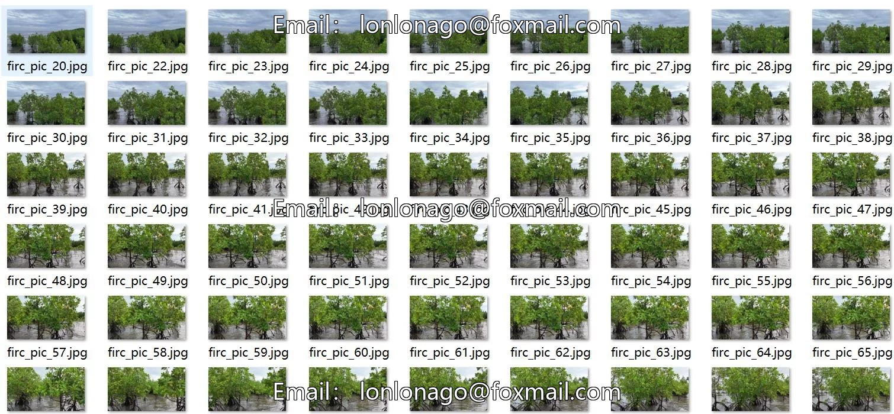
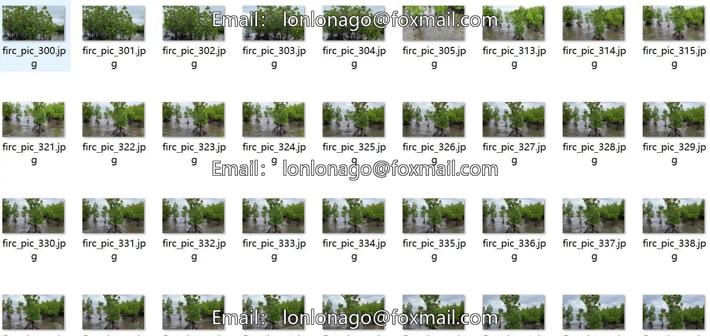
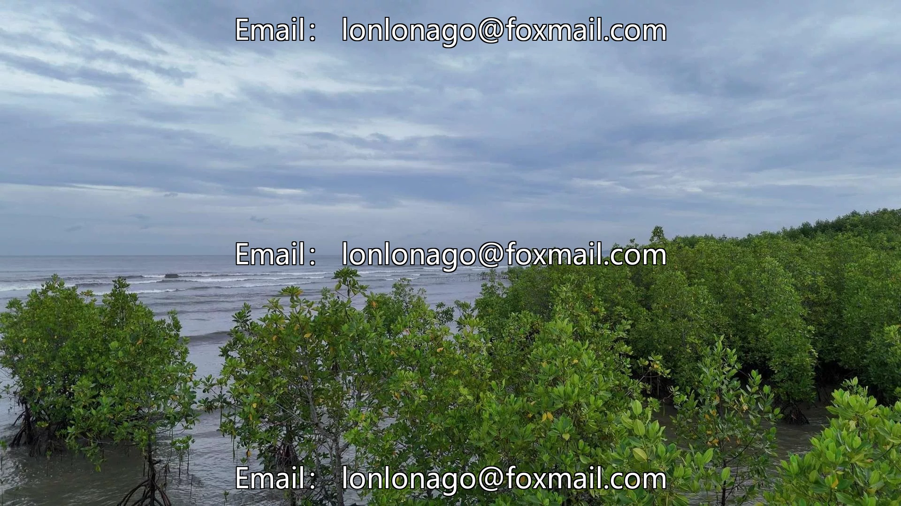
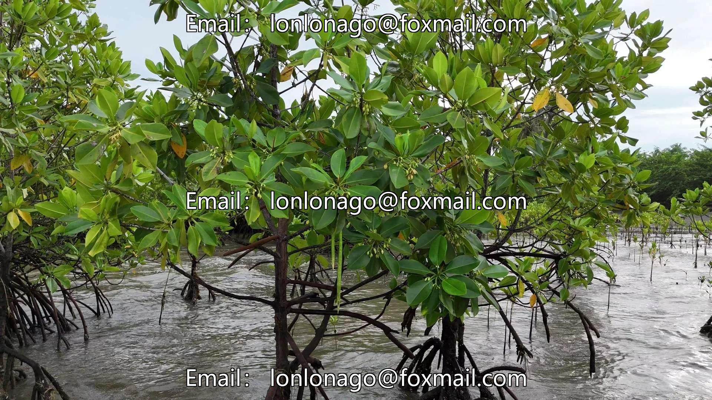
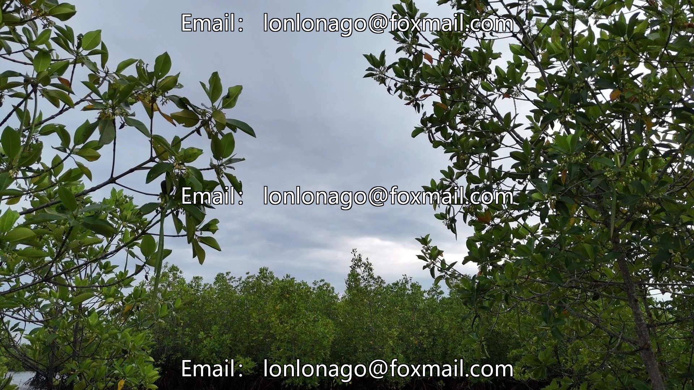

# Drone-viewed mangrove plant axis detection dataset VOC+YOLO format 380

## Body

Drone-viewed mangrove plant axis detection dataset VOC+YOLO format with 380 images in 3 categories
Note: Due to the dataset's replicability, please confirm compliance before purchasing.
Dataset format: Pascal VOC format + YOLO format (txt file without split path, only containing jpg images and corresponding VOC format xml files and yolo format txt files)
Number of images (number of jpg files): 380
Number of annotations (number of xml files): 380
Number of annotations (number of txt files): 380
Number of annotation categories: 3

Label category names (note that the order of categories in the YOLO format does not correspond to this, but is based on the classes.txt file in the labels folder): ["hongshufanzhiti", "kaihua", "youmiaofanzhiti"
["Red mangrove propagules", "Flowering", "Seedling propagules"]
Number of boxes labeled in each category
hongshufanzhiti frame count = 862
Kaihua Frame Count = 1431
youmiaofanzhiti frame count = 6728
Total frame count: 9021
Number of images per category

hongshufanzhiti occupies 264 images
kaihua occupies 284 images
youmiaofanzhiti occupies 380 images
Image resolution: 1920x1080
Labeling tool used: labelImg
Labeling rules: Draw a rectangle around the category
Important note: The dataset does not have separate training, validation, and test sets; you need to partition them yourself.
Special declaration: This dataset does not guarantee the accuracy of the trained models or weight files.

## Images

## Payment

Here is a pay link on Stripe ( https://buy.stripe.com/3cs8yP7sY87d0vu9AB ). Please contact me lonlonago@foxmail.com after funding $89, and I will send you a complete data files , thank you!

